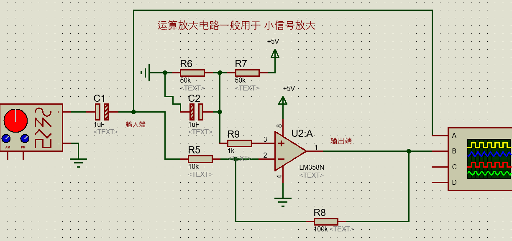

# 02-波峰焊、回流焊、常用集成电路

> 来源：学习通作业详情。共 5 题：单选 3 题、多选 2 题，每题 20 分，满分 100 分。
> 整理日期：2026-10-22。正确答案按页面收录；解析和记忆点为补充的复习说明，非教师原解析。

## 一、单选题

### 1. 图中是一个 LM358 运算放大电路，请问该电路的放大倍数是______倍？（P10）



- A. 10
- B. -100
- C. 100
- D. -10

**正确答案：D。-10。**

**解析：** 信号通过 R5 接到运放的反相输入端（−），R8 从输出端接回反相端，构成反相放大电路。在正常负反馈、未饱和且工作频率适当时，交流电压增益为：

```text
Av = -反馈电阻 / 输入电阻
   = -R8 / R5
   = -100kΩ / 10kΩ
   = -10
```

负号表示输出信号相对于输入反相，幅度放大约 10 倍。不能把它误写成同相放大器的 `1 + Rf/Rin`。R6、R7 构成单电源偏置；这里讨论的是信号变化量的增益，不是把输出绝对电压直接算成输入绝对电压的 -10 倍。

**记忆：** 反相看“负端”，增益“负的反馈除输入”。

### 2. 电路板制作回流焊工艺里，最常用的一种方式中的“回流”，指的是________？（P3末尾）

- A. 高温的气体在回流焊炉中，来回循环流动加热实现焊接
- B. 高温的液体在回流焊炉中，来回循环流动加热实现焊接
- C. 高温的焊锡和助焊剂在焊炉中，产生波峰波谷来加热实现焊接
- D. 以上都不对

**正确答案：A。高温的气体在回流焊炉中，来回循环流动加热实现焊接。**

**解析：** 按本作业口径选 A，描述的是常见热风对流回流焊的加热方式：循环热气体把热量传给电路板和元件。C 描述更接近波峰焊，不能与回流焊混淆。

**易错点：** 严格理解，回流焊的核心是让预先放在焊盘上的焊膏受热熔化、润湿连接处，再冷却形成焊点；不能仅把“回流”理解成气体循环。回流焊也不只有热风加热一种形式。

**记忆：** 本题选热风循环；工艺核心是焊膏熔化再凝固。

### 3. 电路制作工艺中，回流焊与波峰焊的最大区别在于________？（P8）

- A. 前者主要焊接贴片元件，后者主要焊接插孔元件
- B. 以上都不对
- C. 前者主要焊接插孔元件，后者主要焊接贴片元件
- D. 焊接的温度高低不同

**正确答案：A。前者主要焊接贴片元件，后者主要焊接插孔元件。**

**解析：** 回流焊通常先在焊盘上印焊膏、放贴片元件，再整体加热；波峰焊通常让液态焊料形成的波峰接触电路板底面的焊接部位，适合插孔元件的批量焊接。区别重点是工艺和主要应用对象，不是单纯比较温度。题目中的“主要”很重要，实际工艺存在特殊应用，不能理解为绝对只能焊这一类。

**记忆：** 回流配贴片，波峰配插孔。

## 二、多选题

### 4. 关于电路板的回流焊工艺，描述正确的有________？（P8）

- A. 第二步使用 SMT 自动贴片机把元器件放置到指定位置，依靠焊锡膏粘黏元器件
- B. 最后放入波峰焊炉进行加热焊接，再冷却
- C. 最后放入回流焊炉进行加热焊接，再冷却
- D. 首先用漏孔网和刮板，将焊锡膏刮落、滴落到指定的一些焊盘点位上

**正确答案：A、C、D。**

**解析：** 常见回流焊装配顺序是：

1. **印焊膏（D）**：通过钢网开孔和刮刀，把焊膏印到对应焊盘上。原选项的“滴落”是简化措辞，实际通常称钢网印刷。
2. **贴元件（A）**：贴片机把元件放到焊盘位置，焊膏的黏性可暂时固定元件。
3. **回流并冷却（C）**：进入回流焊炉，按温度曲线加热使焊料熔化，随后冷却形成连接。

B 把设备写成了波峰焊炉，因此不选。注意：本题问“哪些正确”，答案按选项字母写 ACD；若问操作顺序，则是 D → A → C。

**记忆：** 印膏 → 贴片 → 回流 → 冷却。

### 5. 波峰焊一般有哪些步骤________？（P8）

- A. 喷助焊剂
- B. 液态焊料的波峰，接触电路板下表面进行焊接
- C. 预热
- D. 冷却

**正确答案：A、B、C、D。**

**解析：** 四项都是波峰焊的常见步骤，但题目给出的字母排列不是操作顺序。通常流程为：

```text
喷助焊剂（A）→ 预热（C）→ 接触焊料波峰（B）→ 冷却（D）
```

助焊剂有助于去除氧化物、改善润湿；预热帮助溶剂挥发并减少突然受热造成的温差；焊料波峰接触底部焊接区域形成连接，随后冷却凝固。

**记忆：** 喷、预、焊、冷；选项全选，顺序 ACBD。

## 答案速查

| 题号 | 题型 | 正确答案 | 复习重点 |
| --- | --- | --- | --- |
| 1 | 单选 | D | 反相增益：-R8/R5 = -10 |
| 2 | 单选 | A | 本题考热风循环；核心是焊膏受热熔化 |
| 3 | 单选 | A | 回流主要贴片，波峰主要插孔 |
| 4 | 多选 | ACD | 印膏、贴片、回流、冷却 |
| 5 | 多选 | ABCD | 全选；工艺顺序 A→C→B→D |

[返回课程目录](../README.md)
