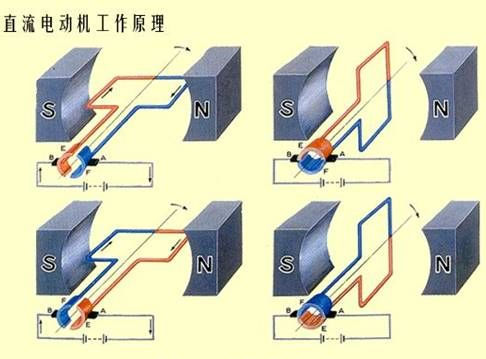
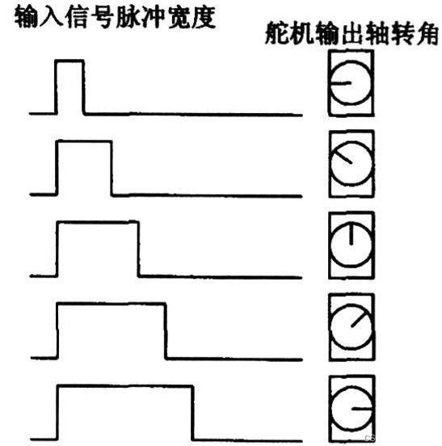

# 06-普通电机、步进电机、伺服电机（舵机）

> 原作业标题：06-普通电机.步进电机.伺服电机(舵机)-new。
> 来源：学习通作业详情。共 16 题：单选题 12 题、多选题 4 题，满分 100 分。
> 整理日期：2026-10-22。正确答案按页面收录；简短解析和记忆点为补充的复习说明，非教师原解析。
> 第 14、15 题配图已保存为本地原图；第 15 题原图有遮挡，未猜填被遮文字。

## 一、单选题

### 1. 控制直流电动机旋转方向和调速的最常用方法是：________ ？ P90 和 课程理解

- A. 用开关管组成H桥控制方向，同时开关管给PWM信号控制转速
- B. 用开关手动控制
- C. 用开关管组成：星-三角电路来控制方向，同时开关管给PWM信号控制转速
- D. 用单片机加继电器控制方向和转速

**正确答案：A。** 用开关管组成H桥控制方向，同时开关管给PWM信号控制转速。

**解析：** H 桥通过切换对角开关管，改变电机两端电压极性来换向；PWM 通过改变占空比调节驱动作用，从而调速。星—三角电路常见于三相电动机起动，不是这里直流电机的控制方式。

**记忆：** H 桥管方向，PWM 占空比管调速。

### 2. 根据步进电机工作原理图，对于步进电机的简单理解是：_____________？ P92

- A. 定子由多个绕组线圈磁极组成，转子永磁体的磁极数量一般为定子绕组磁极数减1，定子磁极依次通电，转子将一步步前进
- B. 以上说法都不对
- C. 定子由多个绕组线圈磁极组成，转子永磁体的磁极数量一般为定子绕组磁极数减2，定子磁极依次通电，转子将一步步前进
- D. 转子由多个绕组线圈磁极组成，定子永磁体的磁极数量一般为定子绕组磁极数减2，定子磁极依次通电，转子将一步步前进

**正确答案：C。** 定子由多个绕组线圈磁极组成，转子永磁体的磁极数量一般为定子绕组磁极数减2，定子磁极依次通电，转子将一步步前进。

**解析：** 按本课程示意模型选 C：定子绕组按顺序通电，产生不同方向的磁场，吸引转子逐步转动。注意“转子磁极数等于定子磁极数减 2”不是所有步进电机的通用设计公式，不同结构的极数、齿数关系不同。页面没有附上题干提到的工作原理图，故不另行补画。

**记忆：** 核心是依次励磁、逐步转动；本题记 C。

### 3. 要控制步进电机的转速，直接调整控制脉冲信号的频率即可？________ （课程实训所学）

- A. 对
- B. 错

**正确答案：A。** 对。

**解析：** 在驱动方式和每脉冲转角固定、且不失步时，脉冲频率越高，每秒走的步数越多，转速越高。实际不能无限提高频率，通常还要考虑负载和加减速，否则可能失步。

**记忆：** 脉冲频率管速度，脉冲数量管角度。

### 4. 直流电动机的工作原理主要基于以下哪种物理现象? P90

- A. 压电效应
- B. 静电感应
- C. 通电导体在磁场中受力
- D. 电磁感应

**正确答案：C。** 通电导体在磁场中受力。

**解析：** 载流导体放在磁场中会受力，线圈两侧的力形成转矩，带动转子旋转。电磁感应主要解释磁通变化产生电动势，不能与本题的电动机受力原理混淆。

**记忆：** 电动机：通电受力而转动。

### 5. 有刷直流电动机中，用于改变电枢绕组电流方向以实现连续旋转的部件是? P90

- A. 换向器
- B. 转子铁芯
- C. 电刷
- D. 定子

**正确答案：A。** 换向器。

**解析：** 换向器随转子旋转，并与固定电刷配合，使绕组在适当位置改变电流方向，让转矩继续推动同一方向转动。电刷主要承担滑动接触、导电作用；题目问直接实现换向的部件，选换向器。

**记忆：** 电刷负责接电，换向器负责换向。

### 6. 直流电动机调速方法中，以下哪种可以实现无级调速且效率高? P90

- A. 改变电枢电压
- B. 改变电枢回路电阻
- C. 改变极对数
- D. 改变励磁电流

**正确答案：A。** 改变电枢电压。

**解析：** 在励磁基本不变时，调节电枢电压可平滑改变转速。采用合适的开关驱动方式时，通常比串电阻调速效率高；串电阻会把部分能量消耗成热。改变励磁电流也能调速，但本题侧重常见的调压调速。

**记忆：** 调压较省，串阻耗热。

### 7. 步进电动机是一种将什么信号转换为角位移的执行器件? P92

- A. 脉冲信号
- B. 交流电压
- C. 直流电压
- D. 模拟电流

**正确答案：A。** 脉冲信号。

**解析：** 步进驱动器把输入脉冲转为绕组的励磁变化，使转子按设定步长运动。脉冲数对应累计转角，频率对应转速，方向由驱动接口或励磁顺序决定。

**记忆：** 一个脉冲走一步，多个脉冲累角度。

### 8. 步进电动机的步距角是指? P91-92

- A. 转子每转一圈所需的脉冲数
- B. 最大允许转角
- C. 定子与转子之间的夹角
- D. 每输入一个脉冲信号，转子转过的角度

**正确答案：D。** 每输入一个脉冲信号，转子转过的角度。

**解析：** 步距角是一个步进动作对应的转角。例如整步步距角为 1.8° 时，一圈需要 360°÷1.8°=200 个整步脉冲；使用细分驱动时，每个输入脉冲对应的角度还会减小。

**记忆：** 步距角看“每步几度”，不是“一圈几步”。

### 9. 步进电动机在低频工作时容易出现什么现象? 刚才看的视频教程

- A. 振荡
- B. 堵转
- C. 失步
- D. 过热

**正确答案：A。** 振荡。

**解析：** 转子每走一步后会在目标位置附近产生机械振荡；在某些低频或共振频段尤其明显。合适的细分驱动、加减速设置或阻尼可改善；振荡严重时也可能进一步造成失步。

**记忆：** 低频易抖动，共振更明显。

### 10. 舵机(伺服电机)通常用于控制? P93

- A. 精确的角度位置
- B. 直线位移
- C. 大扭矩输出
- D. 连续旋转速度

**正确答案：A。** 精确的角度位置。

**解析：** 本题指常见位置型舵机：控制电路比较目标角度与反馈位置，驱动电机纠正偏差，因此主要用于角度定位。连续旋转舵机属于另一类，不能套用同样的角度控制理解。

**记忆：** 位置舵机管角度。

### 11. 标准舵机的控制信号通常是? P94 第三段

- A. 串口数字信号
- B. 周期为20ms的PWM脉冲，脉宽0.5-2.5ms
- C. 模拟电压0-5V
- D. 直流电流信号

**正确答案：B。** 周期为20ms的PWM脉冲，脉宽0.5-2.5ms。

**解析：** 按课程给出的控制范围选 B。20 ms=0.020 s，对应频率 1÷0.020=50 Hz；高电平持续时间用于表达目标位置。实际舵机的脉宽范围、允许频率和可转角度取决于型号，0.5～2.5 ms 并非所有舵机都支持。

**记忆：** 周期约 20 ms；看高电平脉宽定位置。

### 12. 舵机在机器人应用中，主要用于? 课堂所讲和常识

- A. 提供大范围直线运动
- B. 驱动轮子连续旋转
- C. 控制关节角度
- D. 产生高频振动

**正确答案：C。** 控制关节角度。

**解析：** 机器人关节通常需要转到并保持某个角度，位置型舵机的反馈控制适合这个需求。例如机械臂关节或夹爪开合，都可通过控制舵机角度实现。

**记忆：** 关节要定位，舵机控角度。

## 二、多选题

### 13. 直流电动机的主要优点有哪些？______________ P89

- A. 易于控制转动到精确的角度
- B. 调速范围更广，调速平滑
- C. 运行过程中，转矩力量大
- D. 可靠性高，控制方法简单
- E. 通交流电也能连续转动

**正确答案：B、C、D。** 调速范围更广，调速平滑；运行过程中，转矩力量大；可靠性高，控制方法简单。

**解析：** 按课程归纳选 BCD：普通直流电机常具有调速方便、控制简单等特点。A 的精确角度定位通常还需要位置传感器和闭环控制；E 不能作为普通直流电机的普遍特点。转矩大小和可靠性仍取决于型号、额定参数与工况，有刷电机也存在电刷磨损。

**记忆：** 本题记 BCD；普通电机不自带精确定位。

### 14. 尝试画出普通直流电动机的结构图，直流电机一般主要由哪些部分组成：_____________ ？ P90

- A. 转子：导线绕制的线圈和导电铜片
- B. 定子：两块以上的永磁铁
- C. 电刷换向器
- D. 定子：多组绕组线圈

**正确答案：A、B、C。** 转子：导线绕制的线圈和导电铜片；定子：两块以上的永磁铁；电刷换向器。

**解析：** 题图对应永磁有刷直流电机：定子永磁体提供磁场，转子线圈在磁场中受力，电刷和换向器维持供电与换向，因此选 ABC。注意直流电机也有电磁励磁型，定子可以带励磁绕组；D 不选是基于本题的永磁模型，不是说所有直流电机的定子都不能有绕组。

**记忆：** 本图记：永磁定子、线圈转子、电刷换向器。

### 15. 伺服电机(也称舵机)的常见型号为180°舵机，关于180°舵机控制信号下面说法正确的有：________？ P93

- A. 控制信号的高电平时长为1.5ms时，舵机精确转动到90°
- B. 控制信号的高电平时长为1.8ms时，舵机精确转动到180°
- C. 信号一般为周期2ms的方波脉冲信号
- D. 信号一般为频率50Hz的方波脉冲信号
- E. 控制信号的高电平时长为0ms时，舵机精确转动到0°
- F. 控制信号的高电平时长为0.5ms时，舵机精确转动到0°

**正确答案：A、D、F。** 控制信号的高电平时长为1.5ms时，舵机精确转动到90°；信号一般为频率50Hz的方波脉冲信号；控制信号的高电平时长为0.5ms时，舵机精确转动到0°。

**解析：** 按本课程约定：0.5 ms→0°，1.5 ms→90°，2.5 ms→180°；频率 50 Hz 对应周期 20 ms，所以选 ADF。B 的 1.8 ms 不是本模型的 180°端点；C 把 20 ms 写成了 2 ms；E 的 0 ms 表示没有高电平脉冲，不能当作有效的 0°指令。实际角度和端点需按型号确认，不能保证所有舵机都精确符合这组数值。

**记忆：** 半毫秒零度，一点五中间；50 Hz 是 20 ms。

### 16. 舵机的内部通常包含哪些部分? P93图

- A. 控制电路板
- B. 减速齿轮组
- C. 位置反馈电位器
- D. 直流电机

**正确答案：A、B、C、D。** 控制电路板；减速齿轮组；位置反馈电位器；直流电机。

**解析：** 控制板接收指令并比较反馈，直流电机提供动力，减速齿轮组降低转速并提高输出转矩，电位器反馈位置，四部分组成典型的闭环位置控制系统。这里指常见电位器反馈舵机，其他型号也可能采用不同位置传感器。

**记忆：** 板、电机、齿轮、反馈，四样全选。

## 答案速查

| 题号 | 题型 | 正确答案 |
| --- | --- | --- |
| 1 | 单选 | A |
| 2 | 单选 | C |
| 3 | 单选 | A |
| 4 | 单选 | C |
| 5 | 单选 | A |
| 6 | 单选 | A |
| 7 | 单选 | A |
| 8 | 单选 | D |
| 9 | 单选 | A |
| 10 | 单选 | A |
| 11 | 单选 | B |
| 12 | 单选 | C |
| 13 | 多选 | BCD |
| 14 | 多选 | ABC |
| 15 | 多选 | ADF |
| 16 | 多选 | ABCD |

## 三种电机控制要点

| 类型 | 常见控制重点 | 复习提示 |
| --- | --- | --- |
| 有刷直流电机 | H 桥换向、PWM 占空比调速 | 普通开环驱动不直接保证角度定位 |
| 步进电机 | 脉冲数定角度、脉冲频率定速度 | 要在不失步条件下理解 |
| 位置型舵机 | 控制脉冲宽度指定目标位置 | 频率和脉宽范围以型号为准 |

[返回课程目录](../README.md)
